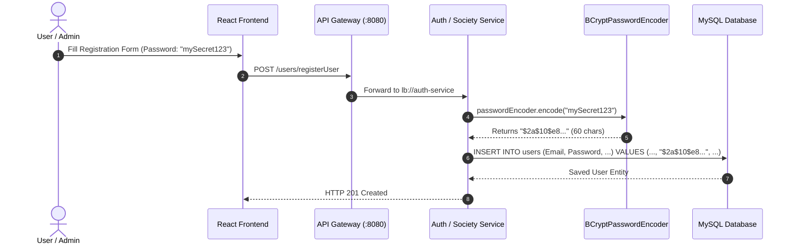
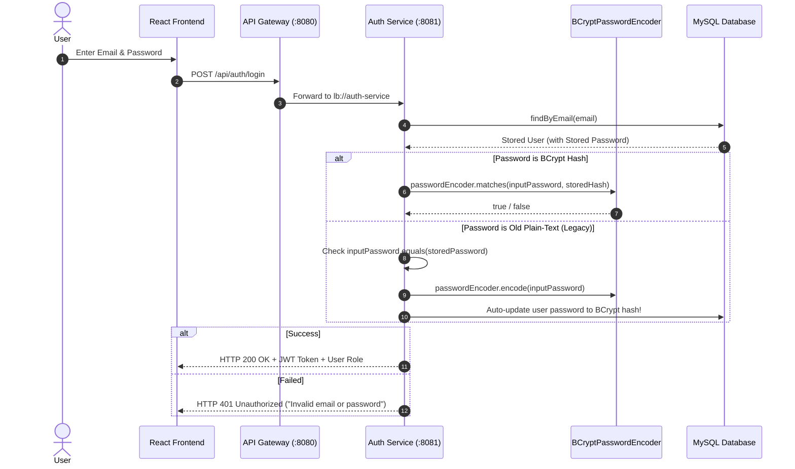

# 🔐 BCrypt Password Hashing & Security Documentation

A comprehensive guide explaining the design, implementation, and security architecture of **BCrypt Password Hashing** in the **Society Management System** microservices.

---

## 📌 1. Overview & Motivation

### Why BCrypt?
Previously, user passwords were saved in **plain text**, which introduces serious security vulnerabilities:
- Anyone with database read access could see all credentials directly.
- Standard hash functions like MD5 or SHA-256 are too fast and vulnerable to rainbow table attacks and GPU-based brute-force.

**BCrypt** solves this by offering:
1. **Adaptive Key Derivation (Work Factor):** Configurable computational cost (default cost factor: 10) to slow down brute-force attacks.
2. **Automatic Salting:** Every hash generates a unique 128-bit random salt embedded into the hash string itself, making rainbow tables ineffective.
3. **One-Way Hashing:** Passwords can never be reverse-engineered or decrypted back to plaintext.

---

## 🔄 2. How BCrypt Works

A BCrypt hash is a **60-character string** formatted as follows:

```
$2a$10$N9qo8uLOickgx2ZMRZoMyeIjZAgcfl7p92ldGxad68LJZdL17lhWy
├───┼──┼──────────────────────┼──────────────────────────────┤
 │   │  └─ 22-character Salt   └─ 31-character Hash
 │   └──── Cost Factor (10 = 2^10 iterations)
 └──────── BCrypt Algorithm Identifier ($2a$)
```

---

## 🏗️ 3. Architecture & Data Flow

### A. User / Society Registration Flow


### B. User Login & Auto-Upgrade Flow


---

## 💻 4. Implementation Details

### Step 1: Maven Dependency
Added `spring-security-crypto` to `auth-service/pom.xml` and `society/pom.xml`:
```xml
<dependency>
    <groupId>org.springframework.security</groupId>
    <artifactId>spring-security-crypto</artifactId>
</dependency>
```
> **Note:** We use `spring-security-crypto` rather than `spring-boot-starter-security` to provide `BCryptPasswordEncoder` without locking down public endpoints with default Spring Security filter chains.

---

### Step 2: Configuration Bean (`SecurityConfig.java`)
```java
package com.sms.society.Config;

import org.springframework.context.annotation.Bean;
import org.springframework.context.annotation.Configuration;
import org.springframework.security.crypto.bcrypt.BCryptPasswordEncoder;
import org.springframework.security.crypto.password.PasswordEncoder;

@Configuration
public class SecurityConfig {

    @Bean
    public PasswordEncoder passwordEncoder() {
        return new BCryptPasswordEncoder();
    }
}
```

---

### Step 3: Registration Logic (`UserRegisService.java`)
```java
@Autowired
private PasswordEncoder passwordEncoder;

// Inside registerUser method:
User newUser = new User();
newUser.setFirstName(requestDTO.getFirstName());
newUser.setLastName(requestDTO.getLastName());
newUser.setEmail(requestDTO.getEmail());
newUser.setPhoneNumber(requestDTO.getPhoneNumber());

// Hashing with BCrypt before persisting
newUser.setPassword(passwordEncoder.encode(requestDTO.getPassword()));
```

---

### Step 4: Login Verification with Auto-Upgrade (`LoginService.java`)
```java
@Autowired
private UserRepository userRepo;

@Autowired
private PasswordEncoder passwordEncoder;

public User login(String email, String password) throws Exception {
    User user = userRepo.findByEmail(email)
            .orElseThrow(() -> new Exception("Invalid email or password."));

    String storedPassword = user.getPassword();
    boolean isMatched = false;

    // 1. Try standard BCrypt verification
    if (storedPassword != null && storedPassword.startsWith("$2a$") || storedPassword.startsWith("$2b$")) {
        isMatched = passwordEncoder.matches(password, storedPassword);
    } 
    // 2. Legacy Plain-Text Fallback with Auto-Migration
    else if (password.equals(storedPassword)) {
        isMatched = true;
        // Upgrade legacy plaintext to BCrypt hash in DB
        user.setPassword(passwordEncoder.encode(password));
        userRepo.save(user);
    }

    if (!isMatched) {
        throw new Exception("Invalid email or password.");
    }

    // 3. Check Society Approval Status (SuperAdmin is exempt)
    boolean isSuperAdmin = user.getRole() != null && "SuperAdmin".equalsIgnoreCase(user.getRole().getRoleName());
    if (!isSuperAdmin) {
        if (user.getSociety() == null) {
            throw new Exception("User is not associated with any registered society.");
        }

        String societyStatus = user.getSociety().getStatus();
        if (societyStatus == null || !"APPROVED".equalsIgnoreCase(societyStatus.trim())) {
            if ("PENDING".equalsIgnoreCase(societyStatus)) {
                throw new Exception("Your society registration is currently pending approval. Please wait for SuperAdmin approval.");
            } else if ("REJECTED".equalsIgnoreCase(societyStatus)) {
                throw new Exception("Your society registration has been rejected. Login is not allowed.");
            } else {
                throw new Exception("Your society is not approved for access. Current status: " + societyStatus);
            }
        }
    }

    return user;
}
```

---

## 🗄️ 5. Database Schema Compatibility

In your MySQL schema (`P20_CreateDB.sql`), the `Password` column is already configured with:
```sql
`Password` varchar(255) NOT NULL
```
- **Required BCrypt Length:** Exactly 60 characters.
- **Available Column Size:** 255 characters.
- **Result:** No database schema alterations or migrations needed!

---

## 🧪 6. Testing & Verification Guide

| Test Scenario | Action | Expected Result |
| :--- | :--- | :--- |
| **New User Registration** | Register user with password `"secret123"` | MySQL `users.Password` contains `$2a$10$...` (60 chars). |
| **New User Login** | Login with `"secret123"` | Login succeeds (HTTP 200) and returns JWT token. |
| **Wrong Password** | Login with `"wrongpass"` | Login rejected with HTTP 401: `"Invalid email or password"`. |
| **Legacy User Migration** | Login with existing plain-text DB user | Login succeeds, and password in DB is automatically upgraded to BCrypt. |
