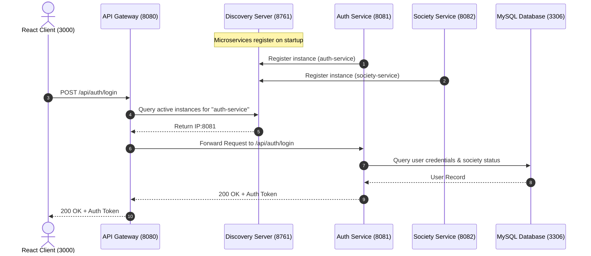

# 🏛️ 01. Microservices Architecture Documentation

The **Society Management System** backend is architected into 5 modular, independently deployable Spring Boot microservices integrated via **Spring Cloud Netflix Eureka** and **Spring Cloud Gateway**.

---

## 🧭 Service Topology & Ports

| Service Name | Artifact / Folder | Port | Description |
|---|---|---|---|
| **Discovery Server** | `discovery-server` | `8761` | Eureka Service Registry & Health Dashboard |
| **API Gateway** | `api-gateway` | `8080` | Reverse Proxy, Dynamic Routing, Global CORS, Load Balancing |
| **Auth Service** | `auth-service` | `8081` | User Login, User Registration, Role Management, BCrypt Hashing |
| **Society Service** | `society` | `8082` | Societies, Flats, Complaints, Notices, Maintenance Rules |
| **Transaction Service** | `transaction-service` | `8083` | Bill Payments, Invoice Generation, Document Records |

---

## 🔄 Gateway Routing Table (`api-gateway`)

The API Gateway listens on port `8080` and dynamically routes traffic using Eureka service discovery (`lb://<service-name>`):

| Route ID | Incoming Path Predicates | Destination Service | Port |
|---|---|---|---|
| `auth-service` | `/api/auth/**`, `/users/**`, `/login/**`, `/registerUser/**`, `/auth/**` | `lb://auth-service` | `8081` |
| `society-service` | `/api/society/**`, `/societies/**`, `/flats/**`, `/owner/**`, `/tenant/**`, `/secretary/**`, `/complaints/**`, `/notices/**` | `lb://society-service` | `8082` |
| `transaction-document-service` | `/api/document/**`, `/documents/**` | `lb://transaction-service` | `8083` |
| `transaction-payment-service` | `/api/payment/**`, `/payments/**` | `lb://transaction-service` | `8083` |

---

## 🌐 Dynamic Service Discovery Flow



---

## 🛡️ Global CORS & Security at Gateway

The Gateway handles cross-origin requests globally so that microservices don't duplicate headers or conflict with browser preflight `OPTIONS` requests:

```properties
spring.cloud.gateway.globalcors.cors-configurations.[/**].allowedOrigins=*
spring.cloud.gateway.globalcors.cors-configurations.[/**].allowedMethods=GET,POST,PUT,DELETE,OPTIONS,PATCH
spring.cloud.gateway.globalcors.cors-configurations.[/**].allowedHeaders=*
spring.cloud.gateway.default-filters[0]=DedupeResponseHeader=Access-Control-Allow-Origin Access-Control-Allow-Credentials Access-Control-Allow-Headers Access-Control-Allow-Methods, RETAIN_FIRST
```

---

## 🚀 Fault Tolerance & Scalability
- **Horizontal Scaling:** Any service can run on multiple ports; Eureka and Gateway will automatically load balance (`RoundRobinLoadBalancer`).
- **Isolation:** If `transaction-service` experiences high load, `auth-service` and `society-service` remain completely unaffected.
