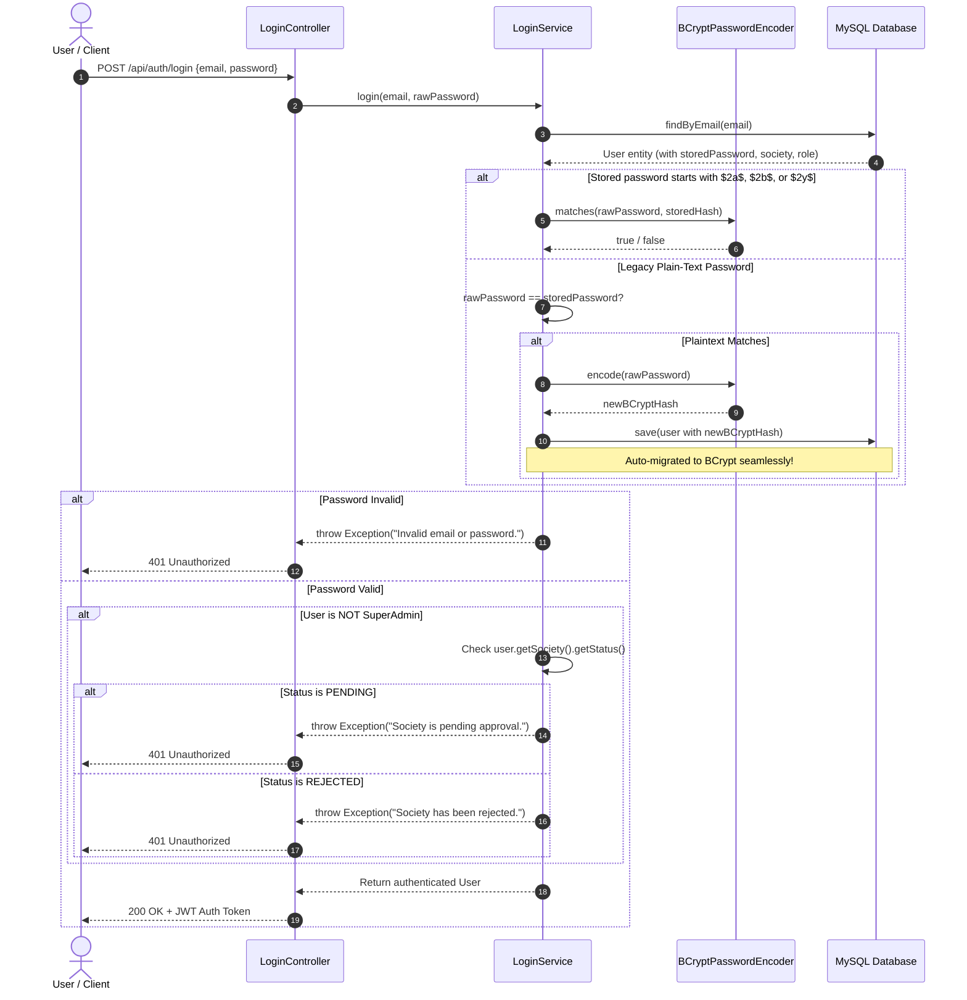

# 🔐 02. BCrypt Password Hashing & Security Documentation

This document covers the implementation, mathematical design, and migration strategy of **BCrypt Password Hashing** in the Society Management System.

---

## 📌 1. Overview & Rationale

Plain-text storage or fast cryptographic hashes (like SHA-256 or MD5) are highly susceptible to rainbow tables and modern GPU-accelerated brute force attacks. 

**BCrypt** solves this through:
1. **Adaptive Work Factor (Cost = 10):** Intentionally CPU-intensive ($2^{10} = 1024$ key expansion rounds), making dictionary attacks computationally infeasible.
2. **Automatic 128-bit Cryptographic Salt:** Every hash creates a unique random salt stored as part of the 60-character hash string.
3. **Irreversible One-Way Function:** Passwords cannot be decrypted.

---

## 🧩 2. BCrypt Hash Anatomy (60 Characters)

Every generated hash follows this exact 60-character format:

```text
$2a$10$N9qo8uLOickgx2ZMRZoMyeIjZAgcfl7p92ldGxad68LJZdL17lhWy
├───┼──┼──────────────────────┼──────────────────────────────┤
 │   │            │                          │
 │   │            │                          └─ 31 Characters: Ciphertext checksum
 │   │            └─ 22 Characters: 128-bit Salt (Base64 encoded)
 │   └─ Cost Factor: 10 (1024 iterations)
 └─ Algorithm Identifier ($2a$ = BCrypt)
```

---

## 🔄 3. Authentication & Society Status Verification Flow



---

## ⚙️ 4. Code Implementation Details

### Maven Dependency (`pom.xml`)
We use `spring-security-crypto` which provides `BCryptPasswordEncoder` without locking down REST endpoints:
```xml
<dependency>
    <groupId>org.springframework.security</groupId>
    <artifactId>spring-security-crypto</artifactId>
</dependency>
```

### Spring Bean Configuration (`SecurityConfig.java`)
```java
@Configuration
public class SecurityConfig {
    @Bean
    public PasswordEncoder passwordEncoder() {
        return new BCryptPasswordEncoder();
    }
}
```

### Registration Hashing (`UserRegisService.java`)
```java
@Autowired
private PasswordEncoder passwordEncoder;

newUser.setPassword(passwordEncoder.encode(requestDTO.getPassword()));
userRepo.save(newUser);
```

### Login Verification & Status Check (`LoginService.java`)
```java
public User login(String email, String password) throws Exception {
    User user = userRepo.findByEmail(email)
            .orElseThrow(() -> new Exception("Invalid email or password."));

    String storedPassword = user.getPassword();
    boolean isMatch = false;

    // 1. BCrypt verification
    if (storedPassword != null && (storedPassword.startsWith("$2a$") || storedPassword.startsWith("$2b$") || storedPassword.startsWith("$2y$"))) {
        isMatch = passwordEncoder.matches(password, storedPassword);
    } 
    // 2. Legacy fallback & auto-migration
    else if (password.equals(storedPassword)) {
        isMatch = true;
        user.setPassword(passwordEncoder.encode(password));
        userRepo.save(user);
    }

    if (!isMatch) {
        throw new Exception("Invalid email or password.");
    }

    // 3. Society approval validation (SuperAdmin exempt)
    boolean isSuperAdmin = user.getRole() != null && "SuperAdmin".equalsIgnoreCase(user.getRole().getRoleName());
    if (!isSuperAdmin) {
        if (user.getSociety() == null) {
            throw new Exception("User is not associated with any registered society.");
        }
        String status = user.getSociety().getStatus();
        if (status == null || !"APPROVED".equalsIgnoreCase(status.trim())) {
            if ("PENDING".equalsIgnoreCase(status)) {
                throw new Exception("Your society registration is currently pending approval. Please wait for SuperAdmin approval.");
            } else if ("REJECTED".equalsIgnoreCase(status)) {
                throw new Exception("Your society registration has been rejected. Login is not allowed.");
            } else {
                throw new Exception("Your society is not approved for access. Status: " + status);
            }
        }
    }

    return user;
}
```
