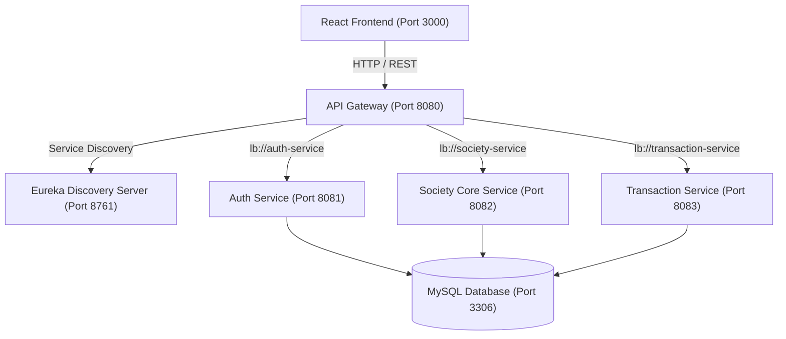

# 📚 Society Management System — Master Documentation

Welcome to the comprehensive technical documentation for the **Society Management System (SMS)**. This documentation provides in-depth architectural guides, security specifications, API references, and deployment procedures for the platform.

---

## 📑 Documentation Index

| # | Document | Description |
|---|---|---|
| **01** | [**Microservices Architecture**](./01_MICROSERVICES_ARCHITECTURE.md) | Complete 5-service architecture, Eureka discovery, Spring Cloud API Gateway routing, and inter-service communication. |
| **02** | [**BCrypt Password Security**](./02_BCRYPT_SECURITY_DOCUMENTATION.md) | BCrypt hashing algorithm, salt generation, auto-upgrade plain-text migration, and society status enforcement. |
| **03** | [**JWT & Authentication Guide**](./03_JWT_AUTHENTICATION_DOCUMENTATION.md) | Token lifecycle, stateless authentication, payload structure, and role-based access control (RBAC). |
| **04** | [**Services & API Reference**](./04_SERVICES_AND_API_REFERENCE.md) | Detailed endpoint documentation, request/response JSON schemas, and HTTP status codes for all microservices. |
| **05** | [**Setup & Running Guide**](./05_SETUP_AND_RUNNING_GUIDE.md) | Step-by-step local setup, MySQL configuration, centralized scripts (`scripts/start-all.*`), and troubleshooting. |

---

## 🏗️ System Overview

The **Society Management System** is built on a modern **Spring Cloud Microservices Architecture** with a **React** single-page application frontend.

---

## 👥 Role Hierarchy & Access Matrix

| Role | Responsibilities | Scope |
|---|---|---|
| **SuperAdmin** | Global platform administrator. Approves/rejects registered societies. | Platform-wide |
| **Admin / Secretary** | Society administrator. Manages flats, registers owners, creates notices, resolves complaints. | Specific Society |
| **Owner** | Flat owner. Pays maintenance, registers tenants, raises complaints, views notices. | Specific Flat / Society |
| **Tenant** | Flat resident. Pays rent/maintenance, raises complaints, views society notices. | Specific Flat / Society |
